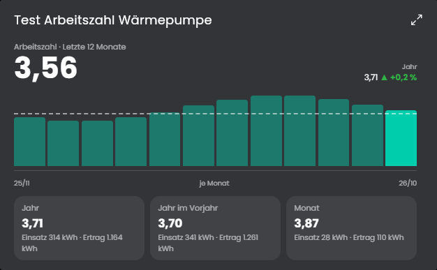
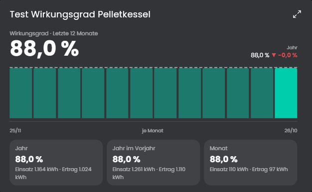

# Arbeitszahl
Zeigt das Verhältnis von Ertrag zu Einsatz zweier Zähler. Der klassische Fall ist die Jahresarbeitszahl einer Wärmepumpe (Wärme geteilt durch Strom). Mit demselben Modul lässt sich auch der Wirkungsgrad eines Kessels berechnen (Wärme geteilt durch Brennstoffenergie, zum Beispiel Pellets in kg mit Heizwert) oder der Ertrag einer Solarthermieanlage im Verhältnis zum Pumpenstrom. Es ist also nicht auf Wärmepumpen beschränkt.

## Inhaltsverzeichnis
- [Arbeitszahl](#arbeitszahl)
  - [Inhaltsverzeichnis](#inhaltsverzeichnis)
  - [1. Konfiguration](#1-konfiguration)
  - [2. Variablen](#2-variablen)
  - [3. Kachel](#3-kachel)
  - [4. Funktionen](#4-funktionen)
  - [5. Spenden](#5-spenden)
  - [6. Lizenz](#6-lizenz)

## 1. Konfiguration

Die Instanz ist ein Kind der Instanz [Verbrauchsquellen](../Verbrauchsquellen/README.md) und wird beim Anlegen mit ihr verbunden. Der Einsatz kommt von dort, der Ertrag ist eine eigene Zählervariable oder der Wärmemengenzähler der Heizung dort.

Feld | Beschreibung
------------ | ----------------
Medium | Welches Medium der [Verbrauchsquellen](../Verbrauchsquellen/README.md) die Instanz auswertet: Strom, Wasser, Gas oder Heizung. Es muss dort befüllt sein. Die Heizung ist die Heizungsvariable des Blocks "Heizung" mit ihrer Einheit, ihrem Preis und ihrem Emissionsfaktor. Standard: Strom.
Einsatz (optional, Standard ist der Hauptzähler der Verbrauchsquellen) | Der Zähler des Einsatzes, bei der Wärmepumpe der Stromzähler. Zähler brauchen die Aggregation "Zähler". Ist das Feld leer, gilt der Wärmemengenzähler aus dem Heizungsblock der Verbrauchsquellen.
Ertrag (Zähler in kWh, leer = Wärmemengenzähler der Heizung) | Der Zähler des Ertrags in kWh, Wh oder MWh, bei der Wärmepumpe der Wärmemengenzähler. Aggregation "Zähler".
Werte der Verbrauchsquellen überschreiben | Mit dem Haken erscheinen die Felder Quelle und Heizwert des Einsatzes. Ohne Quelle gilt der Hauptzähler des Mediums, bei der Heizung deren Variable. Der Heizwert (kWh je Einheit, zum Beispiel 4,8 für Pellets in kg) rechnet einen Einsatz ohne Energie in kWh um. Ist der Einsatz die Heizung der [Verbrauchsquellen](../Verbrauchsquellen/README.md), gilt deren Heizwert. Standard: aus.
Darstellung | Arbeitszahl (Ertrag geteilt durch Einsatz, zum Beispiel 3,8) oder Wirkungsgrad in Prozent (zum Beispiel 88 %).
Archivdiagramm bei Klick öffnen | Ein Klick auf einen Balken der Kachel öffnet den Archivdialog der Einsatzvariable. Standard: an.
Aktualisierungsintervall | Abstand der Neuberechnung in Minuten. Standard: 60.

So wird gerechnet: Ganze Tage bis gestern. Einsatz und Ertrag werden je Zeitraum summiert und geteilt. Die letzten 12 Monate sind die letzten 365 Tage, das ist die übliche Jahresarbeitszahl. Die Instanz zeigt außerdem den laufenden Monat, das Jahr seit dem 1. Januar und denselben Zeitraum im Vorjahr.

## 2. Variablen

Je Zeitraum (`Month`, `Year`, `LastYearYear`, `Last12`):

Variable | Ident | Typ | Beschreibung
------------ | ------------ | ------------ | ----------------
Arbeitszahl oder Wirkungsgrad | `<Zeitraum>_Ratio` | Kommazahl | Ertrag geteilt durch Einsatz, im Modus Wirkungsgrad in Prozent.
Einsatz | `<Zeitraum>_Input` | Kommazahl (kWh) | Eingesetzte Energie im Zeitraum.
Ertrag | `<Zeitraum>_Output` | Kommazahl (kWh) | Gewonnene Energie im Zeitraum.

Weitere Variablen: `Message` (Text) mit einem Satz zu den letzten 12 Monaten. Alle Variablen sind schreibgeschützt und werden vom Modul berechnet. Zusätzlich gibt es die versteckte Textvariable `Data` mit den Daten der Kachel.

## 3. Kachel
Die Instanz erscheint in der Kachel-Visualisierung. Beim Überfahren oder Antippen der Balken erscheint ein Hinweis mit den Werten (auf Touch-Geräten bleibt er bis zum nächsten Tippen).

* Oben steht der Wert der letzten 12 Monate, rechts das laufende Jahr mit der Veränderung zum Vorjahr (grün bei besserem Wert).
* Das Diagramm zeigt den Wert je Monat der letzten zwölf Monate. Die gestrichelte Linie ist der Wert der letzten 12 Monate. Ein Klick öffnet den Archivdialog der Einsatzvariable (in den Einstellungen abschaltbar).
* Karten nennen Jahr, Vorjahr und Monat mit Einsatz und Ertrag. Die Kachel passt sich der Höhe an und blendet Teile aus, statt abzuschneiden.

Die maximierte Ansicht der Kachel zeigt erst ab Symcon 9.1 Inhalt, unter 9.0 bleibt sie leer.

## 4. Funktionen

`void AZL_Calculate(integer $InstanzID);`
Berechnet alles neu und schreibt die Variablen. Läuft automatisch im eingestellten Intervall.

## 5. Spenden
Dieses Modul ist für die nicht kommerzielle Nutzung kostenlos, Schenkungen als Unterstützung für den Autor werden hier akzeptiert:

 

## 6. Lizenz

[CC BY-NC-SA 4.0](https://creativecommons.org/licenses/by-nc-sa/4.0/)
