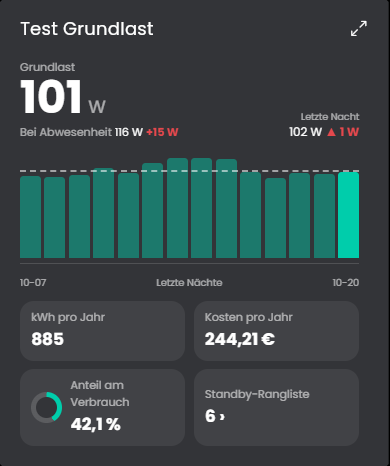

# Grundlast
Ermittelt die Grundlast eines Zählers oder einer Leistungsvariable: die Leistung, die nachts dauerhaft anliegt, wenn nichts Besonderes läuft. Daraus entstehen Jahresverbrauch, Jahreskosten und der Anteil am Gesamtverbrauch. Auf Wunsch gibt es eine Standby-Rangliste einzelner Geräte.

## Inhaltsverzeichnis
- [Grundlast](#grundlast)
  - [Inhaltsverzeichnis](#inhaltsverzeichnis)
  - [1. Konfiguration](#1-konfiguration)
  - [2. Variablen](#2-variablen)
  - [3. Kachel](#3-kachel)
  - [4. Funktionen](#4-funktionen)
  - [5. Spenden](#5-spenden)
  - [6. Lizenz](#6-lizenz)

## 1. Konfiguration

Die Instanz ist ein Kind der Instanz [Verbrauchsquellen](../Verbrauchsquellen/README.md) und wird beim Anlegen mit ihr verbunden. Von dort kommen der Hauptzähler, die Verbraucher und der Preis.

Feld | Beschreibung
------------ | ----------------
Medium | Welches Medium der [Verbrauchsquellen](../Verbrauchsquellen/README.md) die Instanz auswertet: Strom, Wasser oder Gas. Es muss dort befüllt sein. Standard: Strom.
Werte der Verbrauchsquellen überschreiben | Mit dem Haken erscheinen die Felder Preis je Einheit, Preisvariable und Quelle. Sie gelten nur für diese Instanz und ersetzen die Werte aus den [Verbrauchsquellen](../Verbrauchsquellen/README.md), die anderen Werte kommen weiter von dort. So lässt sich dieselbe Auswertung mit anderen Werten nutzen, ohne einen zweiten Splitter anzulegen. Standard: aus.
Quelle (nur mit dem Haken zum Überschreiben) | Archivierte Variable in kWh, Wh, kW oder W. Ohne Auswahl gilt der Hauptzähler der Verbrauchsquellen. Zähler brauchen die Aggregation "Zähler".
Standby-Rangliste aller Verbraucher | Ermittelt die Grundlast auch für jeden Verbraucher der Verbrauchsquellen und sortiert sie. Standard: an.
Abwesenheitsvariable (optional, muss archiviert sein) | Ja/Nein-Variable, die meldet, ob niemand zu Hause ist (zum Beispiel eine Anwesenheits- oder Urlaubsvariable). Mit ihr wertet die Instanz zusätzlich den Verbrauch in den Stunden aus, in denen niemand zu Hause war.
Die Variable ist true, wenn jemand zu Hause ist | Dreht die Abwesenheitsvariable um, wenn sie bei Anwesenheit true meldet. Standard: aus (true = abwesend).
Nacht beginnt um (Uhr) / Nacht endet um (Uhr) | Fenster, in dem normalerweise nichts läuft. Standard: 1 bis 5 Uhr. Ein Fenster über Mitternacht ist möglich (zum Beispiel 23 bis 5).
Auszuwertende Tage | Anzahl der letzten ganzen Tage. Standard: 14.
Archivdiagramm bei Klick öffnen | Ein Klick auf das Diagramm der Kachel öffnet den Archivdialog der Quellvariable, siehe Abschnitt Kachel. Standard: an. Ausgeschaltet bleiben die Hinweise beim Überfahren, der Klick tut nichts.
Aktualisierungsintervall | Abstand der Neuberechnung in Minuten. Standard: 60.

Die Jahreskosten rechnen mit dem Preis der Verbrauchsquellen, bei einer Preisvariable mit deren aktuellem Wert.

Abwesenheit: Eine Stunde zählt als abwesend, wenn die Abwesenheitsvariable mindestens eine halbe Stunde lang abwesend meldete. Der Verbrauch bei Abwesenheit ist der Median der Leistung dieser Stunden in den ausgewerteten Tagen. Der Mehrverbrauch ist dieser Wert minus die Grundlast, also was bei Abwesenheit mehr läuft als nachts im Normalbetrieb. Es braucht mindestens 3 abwesende Stunden, sonst bleiben die Werte auf 0.

Je Nacht zählt die mittlere Leistung im Nachtfenster, die Grundlast ist der Median über die ausgewerteten Nächte. Einzelne Nächte mit laufenden Geräten verfälschen sie damit kaum. Nächte, in denen weniger als die Hälfte der Stunden Werte haben, zählen nicht. Die Jahreswerte rechnen die Grundlast auf 8760 Stunden hoch.

## 2. Variablen

Variable | Ident | Typ | Beschreibung
------------ | ------------ | ------------ | ----------------
Grundlast | `BaseLoad` | Kommazahl | Median der Nächte in Watt.
Letzte Nacht | `LastNight` | Kommazahl | Mittlere Leistung der jüngsten Nacht in Watt.
Grundlast pro Jahr | `YearKWh` | Kommazahl | Hochrechnung in kWh.
Grundlast-Kosten pro Jahr | `YearCost` | Kommazahl | Hochrechnung in EUR.
Anteil am Verbrauch | `Share` | Kommazahl | Grundlast im Verhältnis zum durchschnittlichen Tagesverbrauch der ausgewerteten Tage in Prozent.
Standby-Rangliste | `Standby` | Text | Geräte nach Grundlast absteigend, zum Beispiel "Haus 50.0 W; Kühlschrank 20.0 W".
Leistung bei Abwesenheit | `AbsenceLoad` | Kommazahl | Median der Leistung in den abwesenden Stunden in Watt. Nur mit Abwesenheitsvariable.
Mehrverbrauch bei Abwesenheit | `AbsenceExtra` | Kommazahl | Leistung bei Abwesenheit minus Grundlast in Watt. Nur mit Abwesenheitsvariable.
Stunden bei Abwesenheit | `AbsenceHours` | Ganzzahl | Anzahl der ausgewerteten abwesenden Stunden. Nur mit Abwesenheitsvariable.

Alle Variablen sind schreibgeschützt und werden vom Modul berechnet. Zusätzlich gibt es die versteckte Textvariable `Data` mit den Daten der Kachel.

## 3. Kachel
Die Instanz erscheint in der Kachel-Visualisierung. Beim Überfahren oder Antippen der Balken erscheint ein Hinweis mit den Werten (auf Touch-Geräten bleibt er bis zum nächsten Tippen). Reicht der Platz nicht, scrollt die Kachel.

* Die kleine Kachel zeigt die Grundlast in Watt, die letzte Nacht mit Pfeil gegen den Median und die Balken der ausgewerteten Nächte. Die gestrichelte Linie ist die Grundlast.
* Die maximierte Ansicht ergänzt Karten für Jahresverbrauch, Jahreskosten und Anteil am Verbrauch, mit Abwesenheitsvariable steht links unter der Grundlast klein "Bei Abwesenheit" mit der Leistung und dem Mehrverbrauch gegenüber der Grundlast (rot = mehr). Beim Überfahren oder Antippen nennt der Hinweis zusätzlich die ausgewerteten Stunden.
* Ein Klick auf einen Balken öffnet den Standard-Dialog von Symcon für die Quellvariable mit dem Archivdiagramm. Dort lässt sich die ganze Variable durchgehen: Pfeile blättern zurück und vor, der Kalender springt zu einem Datum, der Pfeil nach oben wechselt zwischen Tag, Woche, Monat und Jahr, im Zahnrad stehen unter anderem "Dynamische Skalierung" und der CSV-Export. Auf Touch-Geräten zeigt das erste Tippen den Hinweis, das zweite öffnet den Dialog. Die Achsen richten sich nach der Darstellung der Quellvariable, bei einem festen Maximum hilft die dynamische Skalierung. In den Einstellungen abschaltbar.
* Die Standby-Rangliste öffnet in einem kleinen Popup, in der großen Ansicht über die Karte "Standby-Rangliste" im Raster, in der kleinen über den Knopf unter dem Diagramm. Das Popup scrollt bei langen Listen und schließt sich mit dem Kreuz, mit Escape oder mit einem Klick daneben. Verbraucher ohne nutzbare Nachtdaten stehen grau am Ende.

Die maximierte Ansicht der Kachel zeigt erst ab Symcon 9.1 Inhalt, unter 9.0 bleibt sie leer.

## 4. Funktionen

`void GRL_Calculate(integer $InstanzID);`
Berechnet die Grundlast neu und schreibt die Variablen. Läuft automatisch im eingestellten Intervall.

## 5. Spenden
Dieses Modul ist für die nicht kommerzielle Nutzung kostenlos, Schenkungen als Unterstützung für den Autor werden hier akzeptiert:

 

## 6. Lizenz

[CC BY-NC-SA 4.0](https://creativecommons.org/licenses/by-nc-sa/4.0/)
