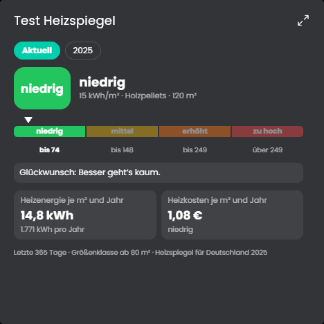

# Heizspiegel
Ordnet die Heizenergie des Gebäudes je Quadratmeter und Jahr in die Kategorien **niedrig, mittel, erhöht und zu hoch** des Heizspiegels für Deutschland ein, abhängig von Energieträger und Gebäudefläche. Dazu die Heizkosten je Quadratmeter (mit Preis) und das Einsparpotenzial bis zur nächstbesseren Kategorie.

## Inhaltsverzeichnis
- [Heizspiegel](#heizspiegel)
  - [Inhaltsverzeichnis](#inhaltsverzeichnis)
  - [1. Voraussetzungen](#1-voraussetzungen)
  - [2. Konfiguration](#2-konfiguration)
  - [3. Kachel](#3-kachel)
  - [4. Variablen](#4-variablen)
  - [5. Funktionen](#5-funktionen)
  - [6. Referenzwerte](#6-referenzwerte)
  - [7. Spenden](#7-spenden)
  - [8. Lizenz](#8-lizenz)

## 1. Voraussetzungen

Die Instanz ist ein Kind der Instanz [Verbrauchsquellen](../Verbrauchsquellen/README.md). Dort müssen eingetragen sein:

* **Heizung (optional)**: die Heizungsvariable (archivierter Zähler oder Leistung) und der **Energieträger** (Erdgas, Heizöl, Fernwärme, Holzpellets oder Strom für Wärmepumpen). "Sonstiges" und "keine Angabe" gibt es im Heizspiegel nicht.
* **Heizwert je Einheit**, wenn die Variable keine Energie misst, zum Beispiel 4,8 kWh je kg Pellets. Für Erdgas (m³) und Heizöl (Liter) rechnet das Modul ohne Eintrag mit etwa 10 kWh je Einheit, wie es der Heizspiegel für die Umrechnung angibt.
* **Wohnfläche**: die beheizte Wohnfläche des **gesamten Gebäudes**, nicht nur der Wohnung. Der Heizspiegel vergleicht Gebäude.
* Optional ein **Preis** je Einheit der Heizungsvariable für die Kosten.

Der Heizspiegel gilt für Heizung und Warmwasser zusammen. Wie das Warmwasser erwärmt wird, entscheidet, ob ein Zuschlag nötig ist, das steht in der Konfiguration unter der Tabelle.

## 2. Konfiguration

Feld | Beschreibung
------------ | ----------------
Werte der Verbrauchsquellen überschreiben | Mit dem Haken erscheinen die Felder Wohnfläche, Warmwasser mit Strom, Heizwert und Preis der Heizung. Sie gelten nur für diese Instanz und ersetzen die Werte aus den [Verbrauchsquellen](../Verbrauchsquellen/README.md), die anderen Werte kommen weiter von dort. So lässt sich dieselbe Auswertung mit anderen Werten nutzen, ohne einen zweiten Splitter anzulegen. Standard: aus.
Verbrauch für den Vergleich | Letzte 365 Tage (bis gestern), letztes Kalenderjahr oder dieses Jahr, hochgerechnet. Die Hochrechnung teilt den Verbrauch seit dem 1. Januar durch die vergangenen Tage und rechnet auf 365 Tage um, sie schwankt stark im Jahresverlauf, weil die Heizung im Winter läuft. Standard: letzte 365 Tage.
Aktualisierungsintervall | Alle wie viele Minuten neu gerechnet wird. Standard: 720 Minuten.
Bereich "Zuschlag für Warmwasser mit Strom" | Aufklappbarer Bereich mit einer Liste, eine Zeile je Ausgabe des Heizspiegels: Jahr, Zuschlag in kWh und EUR je m² und Jahr, jeweils auch mit Wärmepumpe. Vorgegeben ist die Zeile 2025 (24 kWh und 2,65 €, mit Wärmepumpe 9,6 kWh und 2,45 €). Wann der Zuschlag gilt und wie gerechnet wird, steht unter der Tabelle.
Referenztabellen | Baum mit den Grenzen, siehe unten.

**Referenztabellen:** Wie beim [Stromspiegel](../Stromspiegel/README.md) steht jedes **Jahr** als Gruppe im Baum, den du aufklappst. Darunter liegen die Zeilen: Gebäudefläche ab (80, 150, 250 oder 500 m²), Energieträger, die Obergrenzen für niedrig, mittel und erhöht in kWh je m² und Jahr und dieselben Grenzen in Euro. Darüber liegt "zu hoch". Die kWh-Werte müssen aufsteigen, Zeilen mit anderen Werten werden ignoriert. Mit "Neues Jahr" und dem Knopf daneben kopierst du das letzte frühere Jahr als neue Gruppe, "Werte des Heizspiegels 2025 hinzufügen" stellt die Vorgabe wieder her. Erst "Übernehmen" speichert.

**Zuschlag für Warmwasser:** Der Heizspiegel vergleicht Heizenergie **einschließlich Warmwasser**. Das Modul kennt aber nur den Verbrauch der Heizungsvariable. Ob darin auch das Warmwasser steckt, hängt von deiner Anlage ab:

Warmwasser wird erwärmt | Zuschlag | Warum
------------ | ------------ | ----------------
Über die Heizung (Gas-, Öl-, Pelletkessel, Fernwärme, Wärmepumpe mit Warmwasserspeicher) | Nein | Der Verbrauch der Heizungsvariable enthält das Warmwasser schon.
Mit Strom, getrennt von der Heizung (Durchlauferhitzer, Boiler) | Ja | Dieser Strom steht nicht in der Heizungsvariable und fehlt im Vergleich. Der Heizspiegel rechnet dafür pauschal einen festen Wert je Quadratmeter dazu.

Der Zuschlag gilt nur, wenn in den [Verbrauchsquellen](../Verbrauchsquellen/README.md) "Warmwasser mit Strom" angehakt ist. In der Instanz selbst geht es mit "Werte der Verbrauchsquellen überschreiben", dann erscheint der Schalter dort. Ohne Haken gibt es keinen Zuschlag.

Er ist eine Pauschale je m² und Jahr, keine Messung. Das Modul teilt den Jahresverbrauch der Heizung durch die Wohnfläche und addiert die Pauschale:

* Heizenergie je m² = Jahresverbrauch in kWh ÷ Wohnfläche + Zuschlag in kWh je m²
* Heizkosten je m² = Jahreskosten ÷ Wohnfläche + Zuschlag in Euro je m²

Beispiel: 15.000 kWh im Jahr bei 150 m² ergeben 100 kWh/m². Mit Warmwasser über Strom kommen 24 kWh/m² dazu, die Einordnung rechnet mit 124 kWh/m². Der Zuschlag steht nicht nur in der Anzeige, er verschiebt die Kategorie. Ein falscher Schalter kann das Ergebnis um eine ganze Kategorie ändern.

**Eine Zeile je Jahr:** Der Zuschlag gehört zur Ausgabe des Heizspiegels, mit der gerechnet wird. Die Kachel nimmt für ein gewähltes Jahr die Zeile dieses Jahres, "Aktuell" die der neuesten Referenztabelle. Hat ein Jahr keine eigene Zeile, gilt die letzte frühere, gibt es keine frühere, die früheste. Ist die Liste leer, gelten die Werte des Heizspiegels 2025. So lassen sich auch ältere Jahre mit den Werten der damaligen Ausgabe vergleichen. Erscheint eine neue Ausgabe, fügst du neben der neuen Referenztabelle eine Zeile für das Jahr hinzu. Zuschläge, die du vor dieser Liste als einzelne Felder geändert hattest, übernimmt das Modul einmal als Zeile 2025.

Die Kachel zeigt unten einen Hinweis "inklusive Warmwasser mit Strom", wenn der Zuschlag gerechnet wurde. Die Variable `KWhPerM2` enthält den Zuschlag.

## 3. Kachel

* Oben wählst du **Aktuell** oder ein **Jahr** aus der Liste der Referenztabellen. "Aktuell" nimmt den eingestellten Zeitraum und die neueste Tabelle, ein Jahr den Verbrauch dieses Kalenderjahres und die Tabelle desselben Jahres.
* Die Kategorie mit Farbe und dem Wert in kWh je m², darunter die Skala mit vier Kategorien, einem Pfeil für die Lage und den Grenzen für dein Gebäude.
* Die Bedeutung der Kategorie im Wortlaut des Heizspiegels.
* Karten für Heizenergie je m² mit dem Jahresverbrauch, die Heizkosten je m² mit der Kategorie der Kosten und das Einsparpotenzial bis zur nächstbesseren Kategorie, in kWh und Euro.
* Am Ende stehen Zeitraum, Größenklasse, ein Hinweis auf den Zuschlag und die Ausgabe der Tabelle.

**Größenklasse:** Es gilt die größte Klasse, deren Grenze nicht über der Fläche liegt. Fehlt dort der Energieträger (Wärmepumpe und Holzpellets gibt es im Heizspiegel 2025 nur bis 500 m²), nimmt das Modul die nächstkleinere Klasse mit dem Energieträger. Liegt die Fläche unter der kleinsten Klasse (80 m²), gilt die kleinste, die Kachel weist darauf hin.

Die Kachel zeigt die maximierte Ansicht erst ab Symcon 9.1, unter 9.0 bleibt sie leer.

## 4. Variablen

Die Variablen zeigen immer die aktuelle Einordnung.

Variable | Ident | Typ | Beschreibung
------------ | ------------ | ------------ | ----------------
Kategorie | `Category` | Text | niedrig, mittel, erhöht oder zu hoch, in der Sprache des Systems.
Heizenergie je m² und Jahr | `KWhPerM2` | Kommazahl (kWh/m²) | Mit dem Zuschlag für Warmwasser.
Heizkosten je m² und Jahr | `CostPerM2` | Kommazahl (€/m²) | 0 ohne Preis.
Einsparpotenzial bis zur nächstbesseren Kategorie | `SavingKWh` | Kommazahl (kWh) | 0 in der besten Kategorie.
Einsparpotenzial in Geld | `SavingCost` | Kommazahl (€) | 0 ohne Preis.

## 5. Funktionen

`HSP_Update(integer $InstanzID);`
Berechnet die Einordnung neu, setzt die Variablen und aktualisiert die Kachel.

`HSP_CopyYear(integer $InstanzID, integer $Jahr);`
Legt im geöffneten Formular die Tabelle eines neuen Jahres als Kopie des letzten früheren Jahres an. Gilt erst nach "Übernehmen".

`HSP_AddDefaults(integer $InstanzID);`
Fügt im geöffneten Formular die Werte des Heizspiegels 2025 hinzu, falls das Jahr fehlt.

## 6. Referenzwerte

Vorgegeben sind die Werte des **Heizspiegels für Deutschland 2025** (Abrechnungsjahr 2024) der co2online gGmbH ([heizspiegel.de](https://www.heizspiegel.de)). Er vergleicht Heizenergie und Heizkosten je Quadratmeter Gebäudefläche für Heizung und Warmwasser zusammen. Die Tabelle erscheint jährlich neu, frühere und neue Ausgaben trägst du selbst ein. Die Kachel nennt unten die Ausgabe, mit der sie gerechnet hat.

Der Heizspiegel vergleicht keine Energieträger untereinander und bewertet keine einzelne Wohnung in einem zentral beheizten Haus, dafür braucht es die Fläche des ganzen Gebäudes.

## 7. Spenden
Dieses Modul ist für die nicht kommerzielle Nutzung kostenlos, Schenkungen als Unterstützung für den Autor werden hier akzeptiert:

 

## 8. Lizenz

[CC BY-NC-SA 4.0](https://creativecommons.org/licenses/by-nc-sa/4.0/)
