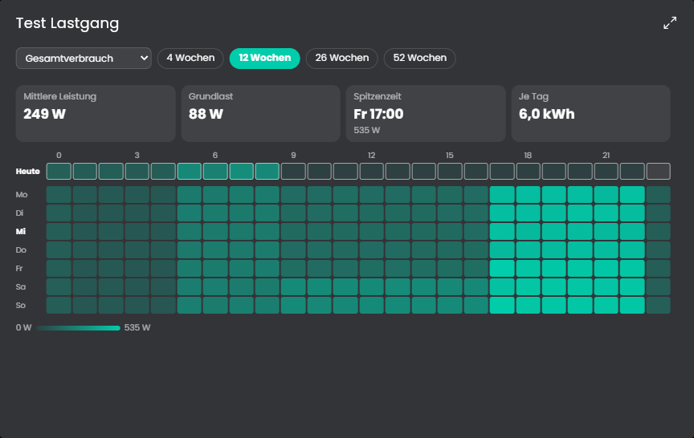

# Lastgang
Zeigt das typische Tagesprofil als Heatmap: Wochentag mal Stunde, mit der mittleren Leistung je Feld. Eine Zeile "Heute" zeigt den bisherigen Tag zum Vergleich. Kennzahlen nennen mittlere Leistung, Grundlast, Spitzenzeit und Verbrauch je Tag. Quelle ist der Gesamtverbrauch, eine Gruppe oder ein Gerät, die Auswahl steht in der Kachel.

## Inhaltsverzeichnis
- [Lastgang](#lastgang)
  - [Inhaltsverzeichnis](#inhaltsverzeichnis)
  - [1. Konfiguration](#1-konfiguration)
  - [2. Kachel](#2-kachel)
  - [3. Funktionen](#3-funktionen)
  - [4. Spenden](#4-spenden)
  - [5. Lizenz](#5-lizenz)

## 1. Konfiguration

Die Instanz ist ein Kind der Instanz [Verbrauchsquellen](../Verbrauchsquellen/README.md) und wird beim Anlegen mit ihr verbunden. Gruppen, Geräte und Hauptzähler kommen von dort.

Feld | Beschreibung
------------ | ----------------
Medium | Welches Medium der [Verbrauchsquellen](../Verbrauchsquellen/README.md) die Instanz auswertet: Strom, Wasser oder Gas. Es muss dort befüllt sein. Standard: Strom.
Zeitraum des Profils beim Start | 4, 12, 26 oder 52 Wochen. Standard: 12 Wochen.
Aktualisierungsintervall | Alle wie viele Minuten das Profil neu gerechnet wird. Standard: 60 Minuten.

## 2. Kachel

Oben wählst du die Quelle (Gesamtverbrauch, eine Gruppe oder ein Gerät, eingerückt wie in den Verbrauchsquellen) und den Zeitraum. Die Auswahl gilt für diese Instanz und bleibt erhalten.

* **Heatmap:** Jede Zeile ist ein Wochentag, jede Spalte eine Stunde. Je dunkler das Feld, desto höher die mittlere Leistung in dieser Stunde, im Verhältnis zum größten Feld. Ein Hinweis zeigt Wochentag, Stunde und Leistung.
* **Heute:** Die oberste Zeile zeigt die Stunden des heutigen Tages bis jetzt. Der Hinweis nennt dazu den typischen Wert dieses Wochentags. Die laufende Stunde zählt nicht zum Profil.
* **Kennzahlen:** Mittlere Leistung über alle Felder, Grundlast (die niedrigste mittlere Leistung einer Stunde über alle Wochentage), Spitzenzeit (das größte Feld) und der mittlere Verbrauch je Tag.

Rechnung: Pro Stunde zählt der Verbrauch aus dem Archiv, mal 1000 ergibt die mittlere Leistung in W. Ein Feld ist der Durchschnitt aller Stunden gleichen Wochentags und gleicher Uhrzeit im Zeitraum. Die Quelle braucht ein Archiv und bei Zählern die Zähler-Aggregation, sonst sind Stundenwerte nicht möglich. Gruppen ohne eigenen Zähler addieren ihre Mitglieder, einschließlich der Untergruppen.

Die Kachel zeigt die maximierte Ansicht erst ab Symcon 9.1, unter 9.0 bleibt sie leer.

## 3. Funktionen

`LGG_Update(integer $InstanzID);`
Berechnet das Profil für die zuletzt gewählte Quelle und Dauer neu und schickt es an die Kachel.

## 4. Spenden
Dieses Modul ist für die nicht kommerzielle Nutzung kostenlos, Schenkungen als Unterstützung für den Autor werden hier akzeptiert:

 

## 5. Lizenz

[CC BY-NC-SA 4.0](https://creativecommons.org/licenses/by-nc-sa/4.0/)
