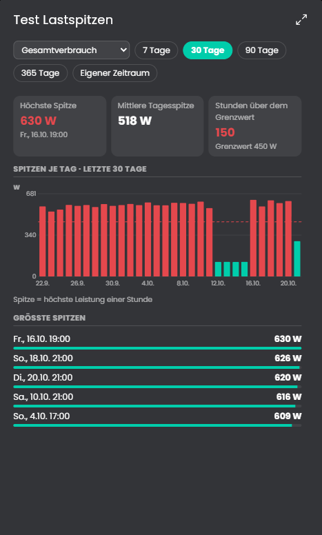

# Lastspitzen
Zeigt die höchste Leistung je Stunde im gewählten Zeitraum: die Spitze je Tag als Diagramm, die größten Spitzen mit Datum und Uhrzeit und auf Wunsch einen Grenzwert mit Alarm. Dazu gibt es Variablen für die Spitze heute, im Monat und im Jahr. Quelle ist der Gesamtverbrauch, eine Gruppe oder ein Gerät, die Auswahl steht in der Kachel.

## Inhaltsverzeichnis
- [Lastspitzen](#lastspitzen)
  - [Inhaltsverzeichnis](#inhaltsverzeichnis)
  - [1. Konfiguration](#1-konfiguration)
  - [2. Kachel](#2-kachel)
  - [3. Variablen](#3-variablen)
  - [4. Funktionen](#4-funktionen)
  - [5. Spenden](#5-spenden)
  - [6. Lizenz](#6-lizenz)

## 1. Konfiguration

Die Instanz ist ein Kind der Instanz [Verbrauchsquellen](../Verbrauchsquellen/README.md) und wird beim Anlegen mit ihr verbunden.

Feld | Beschreibung
------------ | ----------------
Medium | Welches Medium der [Verbrauchsquellen](../Verbrauchsquellen/README.md) die Instanz auswertet: Strom, Wasser oder Gas. Es muss dort befüllt sein. Standard: Strom.
Zeitraum beim Start | 7, 30, 90 oder 365 Tage bis heute. Standard: 30 Tage.
Grenzwert (0 = keiner) | Leistung in W, ab der eine Stunde als Überschreitung zählt, zum Beispiel für den Anschlusswert. Standard: 0.
Anzahl der Spitzen in der Liste | Länge der Liste der größten Spitzen. Standard: 5.
Aktualisierungsintervall | Alle wie viele Minuten neu gerechnet wird. Standard: 15 Minuten.

## 2. Kachel

Oben wählst du die Quelle und den Zeitraum (7, 30, 90, 365 Tage oder einen eigenen Zeitraum mit Von und Bis). Der Zeitraum darf nicht in der Zukunft liegen und höchstens zehn Jahre lang sein.

* **Karten:** höchste Spitze mit Zeitpunkt, mittlere Tagesspitze und, mit Grenzwert, die Zahl der Stunden darüber.
* **Spitzen je Tag:** Säulendiagramm mit der höchsten Stunde jedes Tages. Mit Grenzwert zeigt eine gestrichelte Linie die Grenze, Tage darüber sind rot.
* **Größte Spitzen:** Die Tage mit der höchsten Spitze, je Tag eine Zeile, mit Datum und Uhrzeit.

Was eine Spitze ist: die höchste Leistung innerhalb einer Stunde. Bei Zählern (kWh) ist das die mittlere Leistung der Stunde, denn das Archiv hat dort nur Stundenwerte. Kurzzeitige Spitzen innerhalb einer Stunde sind darin nicht enthalten. Bei Leistungsvariablen (W, kW) zählt der höchste Wert der Stunde. Gruppen ohne Zähler addieren die Stundenwerte ihrer Mitglieder, bei Leistungsvariablen ist das eine obere Schätzung.

Die Kachel zeigt die maximierte Ansicht erst ab Symcon 9.1, unter 9.0 bleibt sie leer.

## 3. Variablen

Variable | Ident | Typ | Beschreibung
------------ | ------------ | ------------ | ----------------
Spitze heute | `PeakToday` | Kommazahl (W) | Höchste Stunde heute, Gesamtverbrauch.
Zeitpunkt der Spitze heute | `PeakTodayTime` | Ganzzahl (Datum/Uhrzeit) | Beginn dieser Stunde.
Spitze im Monat | `PeakMonth` | Kommazahl (W) | Höchste Stunde im laufenden Monat.
Zeitpunkt der Spitze im Monat | `PeakMonthTime` | Ganzzahl (Datum/Uhrzeit) | Beginn dieser Stunde.
Spitze im Jahr | `PeakYear` | Kommazahl (W) | Höchste Stunde im laufenden Jahr.
Zeitpunkt der Spitze im Jahr | `PeakYearTime` | Ganzzahl (Datum/Uhrzeit) | Beginn dieser Stunde.
Grenzwert heute überschritten | `Alarm` | Boolean | Nur mit Grenzwert: an, wenn die Spitze heute über dem Grenzwert liegt. Wird um Mitternacht wieder frei.

Die Variablen gelten immer für den Gesamtverbrauch, unabhängig von der Auswahl in der Kachel.

## 4. Funktionen

`LSP_Update(integer $InstanzID);`
Berechnet die Spitzen für den zuletzt gewählten Zeitraum neu, setzt die Variablen und aktualisiert die Kachel.

## 5. Spenden
Dieses Modul ist für die nicht kommerzielle Nutzung kostenlos, Schenkungen als Unterstützung für den Autor werden hier akzeptiert:

 

## 6. Lizenz

[CC BY-NC-SA 4.0](https://creativecommons.org/licenses/by-nc-sa/4.0/)
