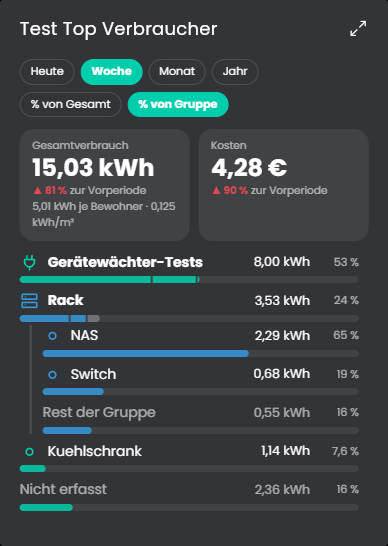
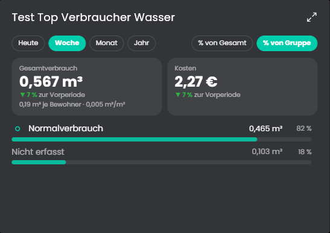
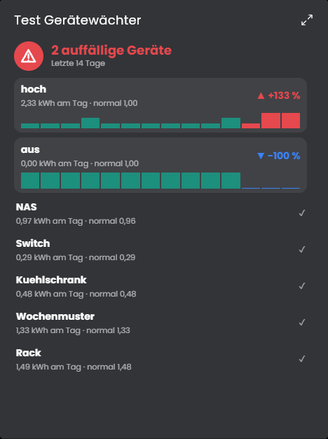
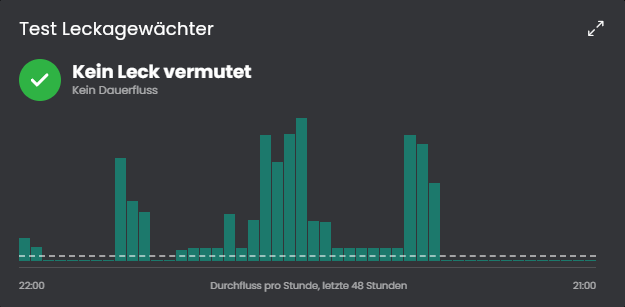
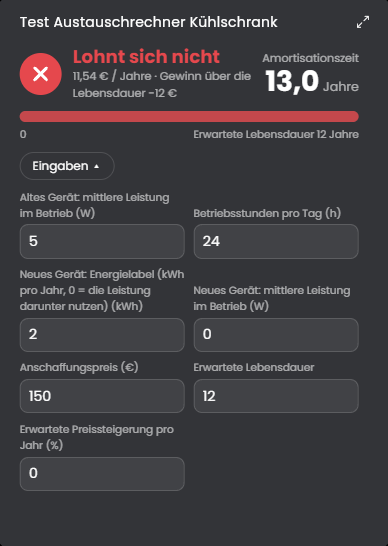
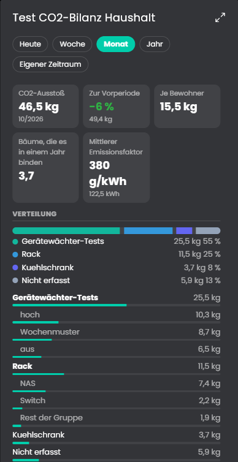
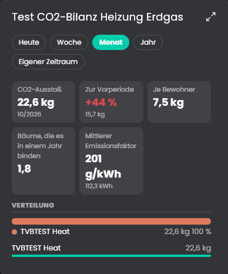
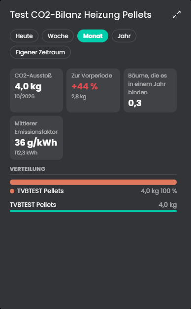
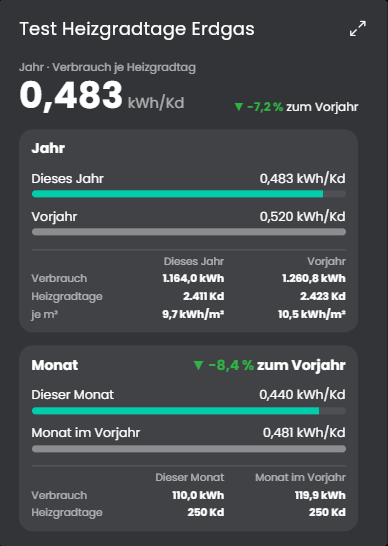

# Verbrauchsanalyse
Wertet den Verbrauch von Strom, Wasser, Gas und Heizung aus dem Archiv aus: Rangliste der größten Verbraucher, Verbrauchsfluss, Lastgang, Grundlast, Verbrauchsberichte per Mail, CO2-Bilanz sowie Auswertungen zu Heizung, Leckagen und Einsparungen. Ein Splitter mit allen Quellen genügt für das ganze Haus.

## Inhaltsverzeichnis
- [Verbrauchsanalyse](#verbrauchsanalyse)
  - [Inhaltsverzeichnis](#inhaltsverzeichnis)
  - [Screenshots](#screenshots)
  - [1. Voraussetzungen](#1-voraussetzungen)
  - [2. Funktionsumfang](#2-funktionsumfang)
  - [3. Enthaltene Module](#3-enthaltene-module)
  - [4. Installation](#4-installation)
  - [5. Konfiguration in IP-Symcon](#5-konfiguration-in-ip-symcon)
  - [6. Spenden](#6-spenden)
  - [7. Lizenz](#7-lizenz)

## Screenshots

## 1. Voraussetzungen

* mindestens IPS Version 9.0
* Die ausgewerteten Variablen sind im Archiv geloggt. Am genauesten arbeiten Zähler mit der Aggregation "Zähler".
* Für Heizgradtage, witterungsbereinigtes Sparziel und die Arbeitszahl eine archivierte Außentemperatur beziehungsweise Zähler für Einsatz und Ertrag.
* Für Berichte per Mail eine SMTP-Instanz von Symcon.
* Die Kacheln zeigen die maximierte Ansicht erst ab Symcon 9.1, unter 9.0 bleibt sie leer.

## 2. Funktionsumfang
* Auswertung von Zählern (kWh, Wh, m³, l) und Leistungswerten (W, kW) für Strom, Wasser, Gas und Heizung über Heute, Woche, Monat und Jahr
* Ein Splitter für das ganze Haus: je Medium Verbraucher, Gruppen mit Untergruppen und Gruppenzählern, Preis (fest oder variabel) und Emissionsfaktor (fest oder stündlich), dazu Heizung, Bewohner und Wohnfläche
* Jede Auswertung wählt ihr Medium und kann einzelne Werte für sich überschreiben
* Rangliste der größten Verbraucher, Verbrauchsfluss als Sankey-Diagramm (auch live), Lastgang als Heatmap und Lastspitzen mit Grenzwert
* Grundlast und Standby-Verbrauch, Gerätewächter für ungewöhnliches Verhalten einzelner Geräte, Leckageerkennung an Wasser- und Gaszählern
* Heizung: witterungsbereinigter Verbrauch über Heizgradtage, Einordnung im Heizspiegel, Arbeitszahl und Wirkungsgrad
* Sparziel mit Fortschritt und Hochrechnung, Einordnung des Haushalts im Stromspiegel, Austauschrechner für Geräte
* CO2-Bilanz für Haushalt und Heizung
* Verbrauchsberichte je Medium mit eigenem Zeitplan und Inhalt, als Text, PDF und CSV in Medienobjekten und per Mail an eigene Empfänger

Die einzelnen Funktionen stehen bei den Instanzen unter "Enthaltene Module" und in der README des jeweiligen Moduls.

## 3. Enthaltene Module

* [Verbrauchsquellen](Verbrauchsquellen/README.md)
  * Splitter mit der gemeinsamen Quellenliste für die Medien Strom, Wasser und Gas: Einheit, Preis, Emissionsfaktor, Verbraucher, Hauptzähler und Gruppen werden hier einmal gepflegt. Dazu kommen die Heizung, die Zahl der Bewohner, die Wohnfläche und die Angabe, ob das Warmwasser mit Strom erwärmt wird.
  * Alle Auswertungen werden mit ihm verbunden, wählen ihr Medium und lesen die Konfiguration von hier.
* [Top Verbraucher](TopVerbraucher/README.md)
  * Zeigt die größten Verbraucher mit Gruppen, Kosten, Vergleich zur Vorperiode und Verbrauch je Bewohner und je m² in einer Kachel.
  * Legt Variablen je Zeitraum für Verbrauch, Kosten und Rangliste an.
* [Verbrauchsfluss](Verbrauchsfluss/README.md)
  * Zeigt als Sankey-Diagramm, wie sich der Verbrauch auf Gruppen und Geräte verteilt, für Heute, Woche, Monat, Jahr, einen eigenen Zeitraum und live.
* [Verbrauchsbericht](Verbrauchsbericht/README.md)
  * Eine Liste von Berichten je Medium mit eigenem Zeitraum, Zeitplan und Inhalt, als Text, PDF und CSV in Medienobjekten und auf Wunsch per Mail an einen eigenen Empfänger.
  * In der Kachel wählt man einen Bericht und erstellt ihn jederzeit, auch für einen eigenen Zeitraum.
* [Lastgang](Lastgang/README.md)
  * Typisches Tagesprofil als Heatmap aus Wochentag und Stunde, für Gesamtverbrauch, Gruppen und Geräte.
* [Lastspitzen](Lastspitzen/README.md)
  * Höchste Leistung je Stunde und Tag, größte Spitzen und optionaler Grenzwert mit Alarmvariable.
* [Grundlast](Grundlast/README.md)
  * Ermittelt die Grundlast aus den Nachtstunden und rechnet sie auf Jahresverbrauch und Jahreskosten hoch, auf Wunsch mit Standby-Rangliste und Verbrauch bei Abwesenheit.
* [Gerätewächter](Geraetewaechter/README.md)
  * Vergleicht jedes Gerät und jede Gruppe mit dem eigenen Normalverhalten und meldet zu hohen und zu niedrigen Verbrauch mit Alarmvariable.
* [Leckagewächter](Leckagewaechter/README.md)
  * Erkennt Dauerfluss an einem Wasser- oder Gaszähler, zählt die Stunden ohne Pause und setzt eine Alarmvariable.
  * Schätzt den Verlust und die Kosten pro Jahr.
* [Sparziel](Sparziel/README.md)
  * Vergleicht den Verbrauch dieses Jahres oder Monats mit dem Vorjahr und prüft das Sparziel in Prozent, optional witterungsbereinigt, mit Hochrechnung und Einsparung in Geld.
* [Austauschrechner](Austauschrechner/README.md)
  * Rechnet, ob sich ein sparsameres Gerät lohnt: Einsparung, Amortisation und Gewinn über die Lebensdauer. Eine Instanz je Gerät.
* [CO2Bilanz](CO2Bilanz/README.md)
  * CO2-Ausstoß aus dem Verbrauch, für den Haushalt oder die Heizung, mit festem oder stündlichem Emissionsfaktor, Vorperiode, Anteilen je Gruppe und Gerät und Baum-Entsprechung.
* [Heizgradtage](Heizgradtage/README.md)
  * Teilt den Verbrauch der Heizung durch die Heizgradtage nach VDI 3807 und vergleicht Monat und Jahr mit dem Vorjahr.
* [Heizspiegel](Heizspiegel/README.md)
  * Ordnet die Heizenergie je m² und die Heizkosten in die Kategorien des Heizspiegels für Deutschland ein.
* [Stromspiegel](Stromspiegel/README.md)
  * Ordnet den Jahresstromverbrauch in die Klassen A bis G des Stromspiegels ein, mit Einsparpotenzial in kWh und Euro.
* [Arbeitszahl](Arbeitszahl/README.md)
  * Teilt den Ertrag durch den Einsatz zweier Zähler: Jahresarbeitszahl einer Wärmepumpe, Wirkungsgrad eines Kessels oder Solarthermie.

## 4. Installation
Die Installation erfolgt über den IP-Symcon Module Store.

## 5. Konfiguration in IP-Symcon
1. Im Archiv sicherstellen, dass die Quellvariablen geloggt werden.
2. Die Instanz *Verbrauchsquellen* anlegen. Im Medium Strom (Wasser, Gas) Einheit und Preis wählen, die Verbraucher mit "Variablen neu suchen" einsammeln, Hauptzähler und Gruppen festlegen und den Emissionsfaktor prüfen. Die Heizung steht in einem eigenen Block (Variable, Energieträger, Heizwert, Preis). Bewohner und Wohnfläche trägt man ebenfalls dort ein.
3. Die Auswertungen anlegen. Sie verbinden sich mit der Verbrauchsquellen-Instanz, im Feld *Medium* wählt man Strom, Wasser, Gas oder (wo es passt) Heizung. Mit dem Haken "Werte der Verbrauchsquellen überschreiben" nutzt eine Instanz abweichende Werte.

Ein Splitter genügt für das ganze Haus. Mehrere Splitter sind möglich, zum Beispiel für eine zweite Heizung. Die weitere Konfiguration steht in der README der jeweiligen Instanz.

## 6. Spenden
Dieses Modul ist für die nicht kommerzielle Nutzung kostenlos, Schenkungen als Unterstützung für den Autor werden hier akzeptiert:

 

## 7. Lizenz

[CC BY-NC-SA 4.0](https://creativecommons.org/licenses/by-nc-sa/4.0/)
