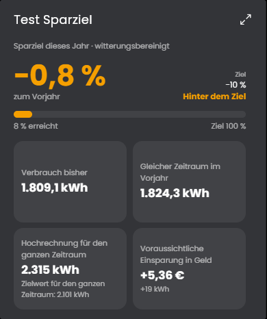

# Sparziel
Vergleicht den Verbrauch dieses Jahres (oder Monats) mit demselben Zeitraum im Vorjahr und prüft, ob das Sparziel erreicht wird. Die Instanz rechnet auf das Ende des Zeitraums hoch und zeigt die voraussichtliche Einsparung in Energie und Geld. Mit einer Außentemperatur lässt sich das Vorjahr witterungsbereinigt vergleichen.

## Inhaltsverzeichnis
- [Sparziel](#sparziel)
  - [Inhaltsverzeichnis](#inhaltsverzeichnis)
  - [1. Konfiguration](#1-konfiguration)
  - [2. Variablen](#2-variablen)
  - [3. Kachel](#3-kachel)
  - [4. Funktionen](#4-funktionen)
  - [5. Spenden](#5-spenden)
  - [6. Lizenz](#6-lizenz)

## 1. Konfiguration

Die Instanz ist ein Kind der Instanz [Verbrauchsquellen](../Verbrauchsquellen/README.md) und wird beim Anlegen mit ihr verbunden. Pro Ziel legt man eine Instanz an, zum Beispiel eine für den Strom und eine für die Heizung (mit eigener Verbrauchsquellen-Instanz).

Feld | Beschreibung
------------ | ----------------
Medium | Welches Medium der [Verbrauchsquellen](../Verbrauchsquellen/README.md) die Instanz auswertet: Strom, Wasser, Gas oder Heizung. Es muss dort befüllt sein. Die Heizung ist die Heizungsvariable des Blocks "Heizung" mit ihrer Einheit, ihrem Preis und ihrem Emissionsfaktor. Standard: Strom.
Werte der Verbrauchsquellen überschreiben | Mit dem Haken erscheinen die Felder Preis je Einheit, Preisvariable und Quelle. Sie gelten nur für diese Instanz und ersetzen die Werte aus den [Verbrauchsquellen](../Verbrauchsquellen/README.md), die anderen Werte kommen weiter von dort. So lässt sich dieselbe Auswertung mit anderen Werten nutzen, ohne einen zweiten Splitter anzulegen. Standard: aus.
Quelle (nur mit dem Haken zum Überschreiben) | Archivierte Zählervariable. Zähler brauchen die Aggregation "Zähler".
Zeitraum | Jahr (seit 1. Januar) oder Monat (seit dem Monatsersten).
Ziel: Einsparung gegenüber dem Vorjahr | Das Ziel in Prozent, zum Beispiel 10 für 10 % weniger. Erlaubt sind 1 bis 99.
Außentemperatur für die Witterungsbereinigung (optional, muss archiviert sein) | Mit Temperatur wird das Vorjahr auf das Wetter dieses Jahres umgerechnet, siehe unten.
Raumtemperatur / Heizgrenze | Nur für die Witterungsbereinigung, wie bei den Heizgradtagen. Standard: 20 und 15 °C.
Archivdiagramm bei Klick öffnen | Ein Klick auf den Fortschrittsbalken der Kachel öffnet den Archivdialog der Quellvariable. Standard: an.
Aktualisierungsintervall | Abstand der Neuberechnung in Minuten. Standard: 60.

So wird gerechnet: Verglichen werden ganze Tage bis gestern mit demselben Zeitraum im Vorjahr. Die Veränderung ist (Verbrauch − Vorjahr) geteilt durch Vorjahr. Das Ziel gilt als erreicht, wenn die Veränderung mindestens so negativ ist wie das Ziel. "Ziel erreicht" ist der erreichte Anteil des Ziels in Prozent (72 % heißt: Von 10 % Einsparung sind 7,2 % geschafft, über 100 % ist übererfüllt). Die Hochrechnung überträgt die bisherige Veränderung auf den ganzen Vorjahreszeitraum, also das ganze Jahr oder den ganzen Monat. Der Zielwert ist der Vorjahresverbrauch minus das Ziel. Die Einsparung in Geld rechnet mit dem Preis der Verbrauchsquellen.

Witterungsbereinigung: Das Vorjahr wird mit dem Verhältnis der Heizgradtage beider Zeiträume umgerechnet, also was es bei dem Wetter dieses Jahres gebraucht hätte. Sie lohnt sich für Heizung (Gas, Pellets, Wärmepumpe). Der Grundverbrauch (Warmwasser) wird dabei mit umgerechnet, das Ergebnis ist deshalb eine Näherung. Gibt es in einem der Zeiträume keine Heizgradtage (Sommer), vergleicht die Instanz unbereinigt.

## 2. Variablen

Variable | Ident | Typ | Beschreibung
------------ | ------------ | ------------ | ----------------
Verbrauch bisher | `Actual` | Kommazahl | Verbrauch im Zeitraum bis gestern.
Gleicher Zeitraum im Vorjahr | `Reference` | Kommazahl | Vorjahresverbrauch, mit Witterungsbereinigung auf das Wetter dieses Jahres umgerechnet.
Veränderung zum Vorjahr | `Change` | Kommazahl (%) | Negativ = weniger Verbrauch.
Ziel erreicht | `Progress` | Kommazahl (%) | Erreichter Anteil des Ziels.
Auf Kurs | `OnTrack` | Ja/Nein | true, wenn das Ziel bei der bisherigen Entwicklung erreicht ist. Für Ereignisse und Benachrichtigungen.
Hochrechnung für den ganzen Zeitraum | `Projected` | Kommazahl | Voraussichtlicher Verbrauch bis zum Ende des Zeitraums.
Zielwert für den ganzen Zeitraum | `TargetValue` | Kommazahl | Verbrauch, bei dem das Ziel genau erreicht wäre.
Voraussichtliche Einsparung | `Savings` | Kommazahl | Vorjahr minus Hochrechnung.
Voraussichtliche Einsparung in Geld | `SavingsCost` | Kommazahl (€) | Dasselbe in Euro.
Ergebnis | `Message` | Text | Kurzer Satz zum Stand.

Alle Variablen sind schreibgeschützt und werden vom Modul berechnet. Zusätzlich gibt es die versteckte Textvariable `Data` mit den Daten der Kachel.

## 3. Kachel
Die Instanz erscheint in der Kachel-Visualisierung. Beim Überfahren oder Antippen der Balken erscheint ein Hinweis mit den Werten (auf Touch-Geräten bleibt er bis zum nächsten Tippen).

* Oben steht die Veränderung zum Vorjahr in Grün (Ziel erreicht), Orange (Einsparung, aber unter dem Ziel) oder Rot (Mehrverbrauch), rechts das Ziel und der Stand.
* Der Balken zeigt, wie viel vom Ziel geschafft ist. Ein Klick öffnet den Archivdialog der Quellvariable, in dem sich der ganze Verlauf durchblättern lässt (in den Einstellungen abschaltbar).
* Karten zeigen den Verbrauch bisher und im Vorjahr, mit mehr Platz auch die Hochrechnung mit dem Zielwert und die Einsparung in Geld. Die Kachel passt sich der Höhe an und scrollt nur, wenn selbst Ziel und Balken nicht hineinpassen.

Die maximierte Ansicht der Kachel zeigt erst ab Symcon 9.1 Inhalt, unter 9.0 bleibt sie leer.

## 4. Funktionen

`void SPZ_Calculate(integer $InstanzID);`
Berechnet alles neu und schreibt die Variablen. Läuft automatisch im eingestellten Intervall.

## 5. Spenden
Dieses Modul ist für die nicht kommerzielle Nutzung kostenlos, Schenkungen als Unterstützung für den Autor werden hier akzeptiert:

 

## 6. Lizenz

[CC BY-NC-SA 4.0](https://creativecommons.org/licenses/by-nc-sa/4.0/)
