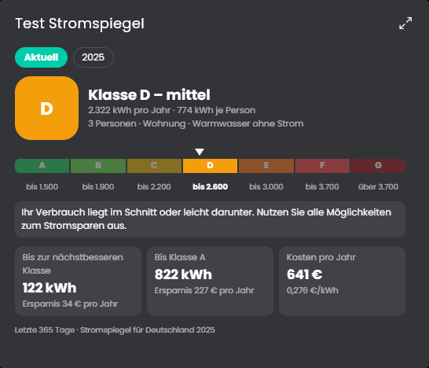

# Stromspiegel
Ordnet den Jahresstromverbrauch des Haushalts in die Klassen A bis G des Stromspiegels für Deutschland ein und zeigt, wie viel bis zur nächstbesseren Klasse und bis Klasse A fehlt, in kWh und in Euro. Die Klasse hängt von der Zahl der Personen, dem Gebäudetyp und davon ab, ob das Warmwasser mit Strom erwärmt wird (Angabe in den [Verbrauchsquellen](../Verbrauchsquellen/README.md)).

## Inhaltsverzeichnis
- [Stromspiegel](#stromspiegel)
  - [Inhaltsverzeichnis](#inhaltsverzeichnis)
  - [1. Voraussetzungen](#1-voraussetzungen)
  - [2. Konfiguration](#2-konfiguration)
  - [3. Kachel](#3-kachel)
  - [4. Variablen](#4-variablen)
  - [5. Funktionen](#5-funktionen)
  - [6. Referenzwerte](#6-referenzwerte)
  - [7. Spenden](#7-spenden)
  - [8. Lizenz](#8-lizenz)

## 1. Voraussetzungen

* Die Instanz ist ein Kind der Instanz [Verbrauchsquellen](../Verbrauchsquellen/README.md). Dort muss die **Zahl der Bewohner** eingetragen sein, sonst meldet die Instanz "Ungültige Konfiguration" und die Kachel weist darauf hin.
* Die Verbrauchsquellen müssen in Energie (kWh, Wh, kW, W) rechnen und der Hauptzähler (oder die Verbraucher) ein Archiv haben.
* Der Stromspiegel vergleicht den **Haushaltsstrom**. Hängen Wärmepumpe, Wallbox oder Heizstab am Hauptzähler, gehören sie nicht dazu und müssen über die Liste "Ausgeschlossene Gruppen und Geräte" herausgerechnet werden.

## 2. Konfiguration

Feld | Beschreibung
------------ | ----------------
Werte der Verbrauchsquellen überschreiben | Mit dem Haken erscheinen die Felder Preis je Einheit, Preisvariable, Bewohner und Warmwasser mit Strom. Sie gelten nur für diese Instanz und ersetzen die Werte aus den [Verbrauchsquellen](../Verbrauchsquellen/README.md), die anderen Werte kommen weiter von dort. So lässt sich dieselbe Auswertung mit anderen Werten nutzen, ohne einen zweiten Splitter anzulegen. Standard: aus.
Gebäudetyp | Wohnung oder Haus. Standard: Wohnung.
Verbrauch für den Vergleich | Letzte 365 Tage (bis gestern), letztes Kalenderjahr oder dieses Jahr, hochgerechnet. Die Hochrechnung teilt den Verbrauch seit dem 1. Januar durch die vergangenen Tage und rechnet auf 365 Tage um, sie schwankt im Jahresverlauf. Standard: letzte 365 Tage.
Ausgeschlossene Gruppen und Geräte | Liste der Gruppen und Geräte der Verbrauchsquellen, die nicht zum Haushaltsstrom zählen. Die Auswahl bietet alle Namen aus den Verbrauchsquellen an, ohne Unterschied zwischen Groß- und Kleinschreibung beim Vergleich. Ihr Verbrauch wird vom Gesamtverbrauch abgezogen und in der Kachel als "nicht mitgezählt" genannt.
Aktualisierungsintervall | Alle wie viele Minuten neu gerechnet wird. Standard: 720 Minuten (zweimal am Tag).
Referenztabellen | Liste mit den Klassengrenzen je Jahr, siehe unten. Vorgegeben ist der Stromspiegel 2025.

Die Zahl der Personen kommt aus den Verbrauchsquellen. Bei mehr als fünf Personen gilt die Zeile "5 und mehr".

**Referenztabellen:** Die Klassengrenzen stehen als Baum am Ende des Formulars, über die volle Breite und mit zwölf sichtbaren Zeilen. Jedes **Jahr** ist eine Gruppe, die du auf- und zuklappst, das neueste ist aufgeklappt. Darunter liegen die Zeilen des Jahres: Gebäudetyp, Warmwasser mit oder ohne Strom, Personenzahl (1 bis 5, 5 steht für fünf und mehr) und die Obergrenzen der Klassen A bis F in kWh pro Jahr. Klasse G liegt über F. Die Werte müssen aufsteigen, Zeilen mit anderen Werten oder ohne Angabe werden ignoriert. Das Jahr einer Zeile ist das Jahr ihrer Gruppe. Ein Jahr braucht nur die Zeilen, die du nutzt.

* **Neues Jahr:** Trage unter "Neues Jahr" das Jahr ein und drücke "Letztes früheres Jahr in das neue Jahr kopieren". Der Baum bekommt dann eine neue Gruppe mit allen Zeilen des letzten früheren Jahres, die du anpassen kannst. Erst "Übernehmen" speichert.
* **Werte 2025:** "Werte des Stromspiegels 2025 hinzufügen" fügt die Vorgabe hinzu, falls du sie gelöscht hast.
* **Frühere Version:** Eine Liste im früheren flachen Format wird beim Öffnen des Formulars in den Baum umgewandelt und beim Übernehmen so gespeichert.

## 3. Kachel

* Oben wählst du **Aktuell** oder ein **Jahr** aus der Liste der Referenztabellen. "Aktuell" nimmt den eingestellten Verbrauchszeitraum und die neueste Tabelle. Ein Jahr nimmt den Verbrauch dieses Kalenderjahres und die Tabelle desselben Jahres (das laufende Jahr wird hochgerechnet). So siehst du, wie dein Haushalt in früheren Jahren eingeordnet gewesen wäre. Dafür braucht das Archiv den Verbrauch aus dem jeweiligen Jahr. Die Personenzahl und der Gebäudetyp gelten für alle Jahre wie eingestellt, Geld wird mit dem aktuellen Preis gerechnet.
* Eine große Klasse A bis G mit Bedeutung (gering, niedrig, mittel, hoch, sehr hoch), darunter Jahresverbrauch, Verbrauch je Person und die Eckdaten des Haushalts.
* Eine Skala mit den sieben Klassen und einem Pfeil für die Lage des Verbrauchs, darunter die Obergrenzen der Klassen für diesen Haushalt.
* Die Bedeutung der Klasse im Wortlaut des Stromspiegels.
* Karten für das Einsparpotenzial bis zur nächstbesseren Klasse und bis Klasse A und für die jährlichen Kosten. Geld wird mit dem aktuellen Preis aus den Verbrauchsquellen gerechnet.
* Am Ende stehen der Zeitraum und die Quelle der Tabelle.

Die Kachel zeigt die maximierte Ansicht erst ab Symcon 9.1, unter 9.0 bleibt sie leer.

## 4. Variablen

Variable | Ident | Typ | Beschreibung
------------ | ------------ | ------------ | ----------------
Klasse | `Class` | Text | A bis G.
Verbrauch pro Jahr | `YearKWh` | Kommazahl (kWh) | Der verglichene Jahresverbrauch.
Verbrauch je Person | `PerPerson` | Kommazahl (kWh) | Jahresverbrauch geteilt durch die Bewohner.
Einsparpotenzial bis Klasse A | `SavingToA` | Kommazahl (kWh) | 0 in Klasse A.
Einsparpotenzial bis Klasse A in Geld | `SavingToACost` | Kommazahl (€) | Mit dem aktuellen Preis.

## 5. Funktionen

`SSP_Update(integer $InstanzID);`
Berechnet die Einordnung neu, setzt die Variablen und aktualisiert die Kachel.

`SSP_CopyYear(integer $InstanzID, integer $Jahr);`
Legt im geöffneten Formular die Tabelle eines neuen Jahres als Kopie des letzten früheren Jahres an. Die Änderung gilt erst nach "Übernehmen".

`SSP_AddDefaults(integer $InstanzID);`
Fügt im geöffneten Formular die Werte des Stromspiegels 2025 hinzu, falls das Jahr in der Liste fehlt.

## 6. Referenzwerte

Vorgegeben sind die Klassengrenzen aus dem **Stromspiegel für Deutschland 2025** der co2online gGmbH ([stromspiegel.de](https://www.stromspiegel.de)), gültig für Haushaltsstrom ohne Strom für Heizung und Elektromobilität. Klasse A bis F gilt "bis" zur genannten Obergrenze, Klasse G darüber. Der Stromspiegel erscheint jährlich neu. Frühere und neue Ausgaben trägst du selbst in der Liste ein, die Kachel nennt unten die Ausgabe, mit der sie gerechnet hat.

## 7. Spenden
Dieses Modul ist für die nicht kommerzielle Nutzung kostenlos, Schenkungen als Unterstützung für den Autor werden hier akzeptiert:

 

## 8. Lizenz

[CC BY-NC-SA 4.0](https://creativecommons.org/licenses/by-nc-sa/4.0/)
