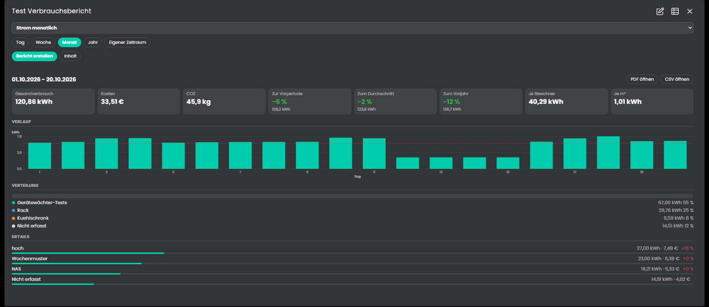
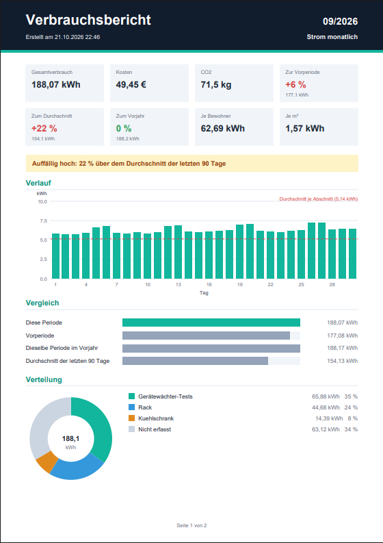
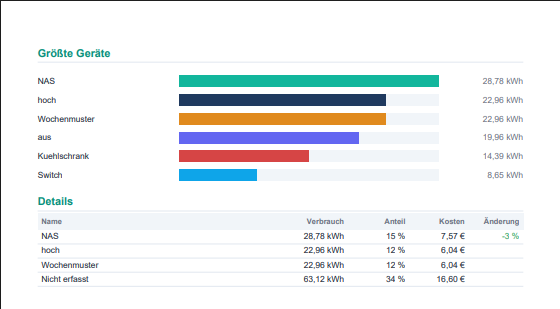

# Verbrauchsbericht
Eine Liste von Berichten über Verbrauch, Kosten und CO2 für Strom, Wasser, Gas oder die Heizung. Jeder Bericht hat sein eigenes Medium, seinen Zeitraum (Tag, Woche, Monat oder Jahr, jeweils die letzte volle Periode), seinen Inhalt, seine Ausgabe (PDF und CSV als Medienobjekte) und auf Wunsch seinen Zeitplan und seinen Mailempfänger. Die Berichte entstehen automatisch zur eingestellten Zeit oder jederzeit auf Knopfdruck in der Kachel, wo man sie aus der Liste wählt.

## Inhaltsverzeichnis
- [Verbrauchsbericht](#verbrauchsbericht)
  - [Inhaltsverzeichnis](#inhaltsverzeichnis)
  - [1. Konfiguration](#1-konfiguration)
  - [2. Kachel](#2-kachel)
  - [3. Variablen](#3-variablen)
  - [4. Funktionen](#4-funktionen)
  - [5. Spenden](#5-spenden)
  - [6. Lizenz](#6-lizenz)

## 1. Konfiguration

Die Instanz ist ein Kind der Instanz [Verbrauchsquellen](../Verbrauchsquellen/README.md) und wird beim Anlegen mit ihr verbunden. Von dort kommen Verbraucher, Gruppen, Hauptzähler, Preis, Bewohner und Wohnfläche.

Feld | Beschreibung
------------ | ----------------
Berichte: Strom, Wasser, Gas, Heizung | Je Medium der [Verbrauchsquellen](../Verbrauchsquellen/README.md) eine Liste, siehe unten. Die Liste bestimmt das Medium des Berichts, es muss dort befüllt sein. Jede Liste zeigt nur die Spalten, die das Medium nutzen kann: Die Heizung ist die Heizungsvariable des Blocks "Heizung" mit ihrer Einheit, ihrem Preis und ihrem Emissionsfaktor, ohne Geräteliste und Restzeile, darum fehlen dort die Spalten Liste, Geräte und Nicht erfasst. Neue Instanzen haben in der Liste Strom einen Bericht "Report". Jeder Name muss über alle Listen einmalig sein.
SMTP-Instanz für die Mail | Die Instanz *SMTP* von Symcon mit den Zugangsdaten, für alle Berichte mit Mail. Pflicht, sobald ein Bericht per Mail geht.
Dezimalkomma (für deutsches Excel) | Schreibt Zahlen mit Komma statt Punkt, in CSV, PDF und Text. Standard: an.
Werte der Verbrauchsquellen überschreiben | Mit dem Haken erscheinen die Felder Preis je Einheit, Preisvariable, Emissionsfaktor, Faktor-Variable, Bewohner und Wohnfläche. Sie gelten für alle Berichte dieser Instanz und ersetzen die Werte aus den [Verbrauchsquellen](../Verbrauchsquellen/README.md), die anderen Werte kommen weiter von dort. Standard: aus.

Spalten der Berichtslisten (eine Zeile je Bericht):

Spalte | Beschreibung
------------ | ----------------
Name | Eindeutiger Name, auch in Betreff, Medienobjekten und Kachel. Wer ihn ändert, bekommt neue Medienobjekte, die alten werden entfernt.
Zeitraum | Tag, Woche, Monat oder Jahr. Berichtet wird immer die letzte vollständige Periode: gestern, die Vorwoche (Montag bis Sonntag), der Vormonat oder das Vorjahr. Standard: Tag.
Automatisch | Erstellt den Bericht zur eingestellten Zeit. Ohne Haken entsteht er nur auf Knopfdruck in der Kachel. Standard: aus.
Stunde, Minute | Uhrzeit des Berichts. Standard: 7:00.
Wochentag | Nur bei Wochenberichten. Standard: Montag.
Tag im Monat | Nur bei Monatsberichten, Jahresberichte erscheinen an diesem Tag im Januar. Erlaubt sind 1 bis 28. Standard: 1.
Mail | Verschickt den Bericht nach dem Erstellen über die SMTP-Instanz. Standard: aus.
Empfänger | Eine oder mehrere Adressen, mit Komma getrennt. Leer = Standardadresse der SMTP-Instanz.
Betreff | Leer = "Verbrauchsbericht <Name> <Zeitraum>". `{name}` und `{period}` werden durch Namen und Zeitraum des Berichts ersetzt.
PDF | Erstellt das PDF mit Diagrammen als Medienobjekt. Standard: aus.
CSV | Erstellt die CSV (für Excel) als Medienobjekt. Standard: an.
Kosten | Kosten im Text und je Zeile. Je Stunde mit der Preisvariable der Verbrauchsquellen, sonst mit dem festen Preis. Standard: an.
Vergleich | Veränderung zur Vorperiode (Vortag, Vorwoche, Vormonat, Vorjahr) und zum Durchschnitt der Zeit davor. Standard: an.
Vorjahr | Vergleich mit derselben Periode im Vorjahr, nicht bei Jahresberichten. Standard: aus.
Hinweis | Steht "Auffällig hoch/niedrig" im Text, wenn die Periode stark vom Durchschnitt abweicht. Standard: an.
Kennzahlen | Verbrauch je Bewohner und je m², wenn die Verbrauchsquellen Bewohner und Wohnfläche kennen. Standard: aus.
CO2 | Zeigt das CO2 des Verbrauchs in Text, Kachel, PDF und CSV. Der Emissionsfaktor kommt aus den Verbrauchsquellen (je Medium, für die Heizung im Heizungsblock). Ohne Faktor (zum Beispiel bei Wasser) gibt es kein CO2. Hat das Medium in den Verbrauchsquellen eine Faktor-Variable, zählt jede Stunde mit ihrem Faktor, genau wie in der CO2Bilanz, sonst gilt der feste Faktor. Die CO2-Spalte der Zeilen rechnet mit dem mittleren Faktor des Zeitraums. Standard: an.
Nicht erfasst | Zeile "Nicht erfasst" gegenüber dem Hauptzähler, nicht bei der Heizung. Standard: an.
Liste | Liste der Verbraucher: keine, Gruppen und Geräte (eingerückt) oder die größten Geräte, nicht bei der Heizung. Standard: Gruppen und Geräte.
Geräte | Länge der Liste bei den größten Geräten. Standard: 5.

Der Durchschnitt und die Schwelle des Hinweises hängen vom Zeitraum ab:

Zeitraum | Durchschnitt über | Hinweis ab Abweichung
------------ | ------------ | ----------------
Tag | 14 Tage davor | 25 %
Woche | 28 Tage davor | 20 %
Monat | 90 Tage davor | 15 %
Jahr | 365 Tage davor | 10 %

Ausgabe: Der Bericht steht als Text in den Variablen der Instanz (der zuletzt erstellte Bericht) und, wenn PDF oder CSV eingeschaltet sind, je Bericht als Medienobjekte `<Name> (PDF)` und `<Name> (CSV)` unter der Instanz. Sie werden beim nächsten Bericht überschrieben und entfernt, wenn der Haken fällt oder der Bericht aus der Liste verschwindet. Es entstehen keine Dateien außerhalb der Medien von Symcon. Mit Mail hängt das PDF (sonst die CSV) an, aus dem Medienobjekt.

Beim Übernehmen der Einstellungen füllt sich nur der Text des gewählten Berichts, Medienobjekt und Mail entstehen erst zur Berichtszeit oder auf Knopfdruck. Ein Termin, der bei einer Änderung der Einstellungen schon verstrichen ist, wird nicht nachgeholt. Die Instanz läuft mit einem gemeinsamen Zeitgeber für alle Berichte, der höchstens sechs Stunden am Stück wartet.

CSV-Spalten: Zeitraum, Ebene (0 = oberste Ebene, 1 = Mitglied einer Gruppe), Name, Verbrauch, Einheit, Anteil in %, Kosten in EUR, Vorperiode, Veränderung in %, CO2 in kg. Die Kosten je Zeile sind der Verbrauch mal der Durchschnittspreis der Periode. Die Datei ist UTF-8 mit Bytemarke, Trennzeichen Semikolon. Ohne Zeilen (zum Beispiel bei der Heizung) steht eine Zeile mit der Summe des Berichts darin. Das PDF nennt oben rechts den Namen des Berichts.

## 2. Kachel

Berichte erstellst du nicht im Konfigurationsformular, sondern in der Kachel-Visualisierung. Das Formular enthält die Liste der Berichte und die gemeinsamen Einstellungen.

* Gibt es mehrere Berichte, stehen oben ihre Namen als Reiter, ab fünf Berichten als Auswahlliste. Die Wahl gilt für den Bericht: Zeitraum, Inhalt, PDF, CSV und Mailempfänger der Kachel gelten dann für ihn. Jeder Bericht lässt sich jederzeit erstellen, auch ohne Zeitplan.
* Zeitraum wählen (Tag, Woche, Monat, Jahr oder "Eigener Zeitraum"; vorbelegt ist der Zeitraum des Berichts) und "Bericht erstellen" drücken. Beim eigenen Zeitraum erscheinen zwei Datumsfelder "Von" und "Bis", beide Tage sind eingeschlossen. Der Zeitraum darf nicht in der Zukunft liegen und höchstens zehn Jahre lang sein. Verglichen wird mit dem gleich langen Zeitraum direkt davor, der Durchschnitt reicht bis zum Doppelten der Länge zurück (mindestens 14, höchstens 365 Tage). Das Verlaufsdiagramm teilt nach Stunden (bis 2 Tage), Tagen (bis 62 Tage) oder Monaten. Der Bericht entsteht sofort mit allen eingestellten Inhalten, schreibt PDF und CSV als Medienobjekte und aktualisiert die Variablen. Der gewählte Zeitraum gilt nur für diesen Bericht, der Zeitplan bleibt unverändert.
* "Per Mail senden" erstellt den Bericht und verschickt ihn über die gewählte SMTP-Instanz an den Empfänger des Berichts. Die Schaltfläche erscheint nur, wenn eine SMTP-Instanz gewählt ist.
* "PDF öffnen" und "CSV öffnen" laden den letzten Bericht direkt herunter, der Browser speichert die Datei ohne weiteren Klick. Der Dateiname enthält den Zeitraum.
* "Inhalt" öffnet ein Fenster mit den Einstellungen zum Inhalt: Kosten, Vergleiche, Hinweis, Kennzahlen, "Nicht erfasst" und die Liste der Verbraucher (keine, Gruppen und Geräte oder die größten Geräte mit Anzahl). Sie gelten für den gewählten Bericht, jede Änderung gilt sofort und steht in seiner Zeile der Berichtsliste.
* Darunter steht der Bericht aufbereitet: Kennzahlenkarten mit Vergleichen (rot bei mehr, grün bei weniger Verbrauch), Hinweis, Verlaufsdiagramm mit Durchschnittslinie, Verteilung als Balken mit Legende und die Details mit Anteilsbalken und Veränderung je Gruppe und Gerät.

Die Kachel zeigt die maximierte Ansicht erst ab Symcon 9.1, unter 9.0 bleibt sie leer.

## 3. Variablen

Variable | Ident | Typ | Beschreibung
------------ | ------------ | ------------ | ----------------
Bericht | `ReportText` | Text | Der Bericht als Text.
Zeitraum des Berichts | `ReportPeriod` | Text | Zum Beispiel 20.10.2026, Woche 42/2026, 09/2026 oder 2025.
Gesamtverbrauch | `Total` | Kommazahl | Verbrauch der Periode.
Kosten | `Cost` | Kommazahl (€) | Kosten der Periode.
Veränderung zur Vorperiode | `ChangePrevious` | Kommazahl (%) | Gegenüber der Periode davor.
Veränderung zur selben Periode im Vorjahr | `ChangeLastYear` | Kommazahl (%) | Nur mit eingeschaltetem Vorjahresvergleich.
Veränderung zum Durchschnitt | `ChangeAverage` | Kommazahl (%) | Gegenüber dem Durchschnitt der Zeit davor.
Hinweis | `Notice` | Text | "Auffällig hoch/niedrig" oder leer.

Die Variablen zeigen den zuletzt erstellten Bericht der Liste. Alle Variablen sind schreibgeschützt und werden vom Modul berechnet.

## 4. Funktionen

`string VBR_CreateReport(integer $InstanzID, string $Name);`
Erstellt den Bericht mit dem Namen aus der Liste für die letzte volle Periode, schreibt Variablen und Medienobjekte und gibt den Text zurück. Ohne Namen (leerer Text) gilt der in der Kachel gewählte Bericht. Gibt es den Bericht nicht, kommt ein leerer Text zurück.

`boolean VBR_SendReport(integer $InstanzID, string $Name);`
Erstellt den Bericht und schickt ihn per Mail an den Empfänger des Berichts (ohne Empfänger an die Standardadresse der SMTP-Instanz). Gibt true zurück, wenn der Versand geklappt hat.

Für mehrere Berichte brauchst du keine weiteren Instanzen, sie stehen in der Liste. Mehrere Instanzen lohnen nur für verschiedene Splitter oder überschriebene Werte.

## 5. Spenden
Dieses Modul ist für die nicht kommerzielle Nutzung kostenlos, Schenkungen als Unterstützung für den Autor werden hier akzeptiert:

 

## 6. Lizenz

[CC BY-NC-SA 4.0](https://creativecommons.org/licenses/by-nc-sa/4.0/)
