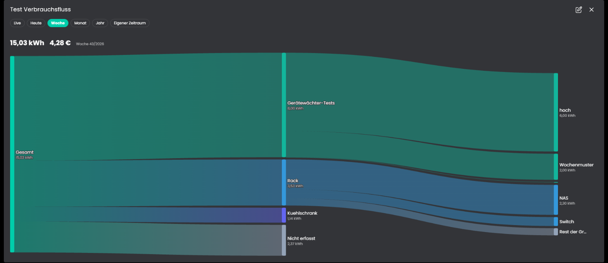

# Verbrauchsfluss
Zeigt den Verbrauch aus den Verbrauchsquellen als Sankey-Diagramm in der Kachel-Visualisierung: vom Hauptzähler über die Gruppen zu den Geräten, dazu der nicht erfasste Rest. Die Breite eines Flusses ist sein Anteil am Gesamtverbrauch. Der Zeitraum wird in der Kachel gewählt, und es gibt eine Live-Ansicht mit der aktuellen Leistung.

## Inhaltsverzeichnis
- [Verbrauchsfluss](#verbrauchsfluss)
  - [Inhaltsverzeichnis](#inhaltsverzeichnis)
  - [1. Konfiguration](#1-konfiguration)
  - [2. Kachel](#2-kachel)
  - [3. Funktionen](#3-funktionen)
  - [4. Spenden](#4-spenden)
  - [5. Lizenz](#5-lizenz)

## 1. Konfiguration

Die Instanz ist ein Kind der Instanz [Verbrauchsquellen](../Verbrauchsquellen/README.md) und wird beim Anlegen mit ihr verbunden. Von dort kommen Verbraucher, Gruppen, Hauptzähler und Preis. Eigene Flüsse trägst du nicht ein, das Diagramm entsteht aus der Struktur der Verbrauchsquellen.

Feld | Beschreibung
------------ | ----------------
Medium | Welches Medium der [Verbrauchsquellen](../Verbrauchsquellen/README.md) die Instanz auswertet: Strom, Wasser oder Gas. Es muss dort befüllt sein. Standard: Strom.
Werte der Verbrauchsquellen überschreiben | Mit dem Haken erscheinen die Felder Preis je Einheit und Preisvariable. Sie gelten nur für diese Instanz und ersetzen die Werte aus den [Verbrauchsquellen](../Verbrauchsquellen/README.md), die anderen Werte kommen weiter von dort. So lässt sich dieselbe Auswertung mit anderen Werten nutzen, ohne einen zweiten Splitter anzulegen. Standard: aus.
Zeitraum beim Start | Heute, Woche, Monat oder Jahr, jeweils bis jetzt. Standard: Monat.
Kleinere Anteile als "Weitere" zusammenfassen | Anteile unter diesem Prozentsatz des Gesamtverbrauchs werden je Gruppe zu einem Knoten "Weitere" zusammengefasst, sobald es mindestens zwei sind. 0 zeigt alles. Standard: 2 %.
Nicht erfasster Verbrauch | Zeigt den Rest gegenüber dem Hauptzähler als eigenen Knoten. Braucht einen Hauptzähler. Standard: an.
Kosten anzeigen | Kosten im Kopf und in den Hinweisen. Standard: an.
Archivdiagramm bei Klick öffnen | Ein Klick auf einen Knoten öffnet den Archivdialog der Variable. Auf Touch-Geräten zeigt das erste Tippen den Hinweis, das zweite öffnet. Standard: an.
Aktualisierungsintervall der Live-Anzeige | Alle wie viele Sekunden die Live-Ansicht neu rechnet. Standard: 15 s.
Aktualisierungsintervall | Alle wie viele Minuten der gewählte Zeitraum neu gerechnet wird. Standard: 60 Minuten.

## 2. Kachel

Oben wählst du den Zeitraum: Live, Heute, Woche, Monat, Jahr oder Eigener Zeitraum. Beim eigenen Zeitraum erscheinen zwei Datumsfelder, beide Tage sind eingeschlossen. Der Zeitraum darf nicht in der Zukunft liegen und höchstens zehn Jahre lang sein. Die Auswahl gilt für diese Instanz und bleibt erhalten.

Darunter stehen Gesamtverbrauch, Kosten und das Diagramm. Beim Überfahren oder Antippen zeigt ein Hinweis Name, Verbrauch, Anteil und Kosten eines Knotens oder Flusses. Die Kachel scrollt, wenn der Platz für das Diagramm nicht reicht.

Rechnung: Der Gesamtverbrauch ist der Hauptzähler, ohne ihn die Summe der obersten Ebene. Gruppen mit Gruppenzähler zeigen dessen Wert und die Differenz zu den Mitgliedern als "Rest der Gruppe", wie in Top Verbraucher. Die Kosten rechnen je Stunde mit der Preisvariable, sonst mit dem festen Preis.

**Live:** Die Live-Ansicht zeigt Leistung in W (bei Volumen l/h), Kosten in €/h:
* Leistungsvariablen (W, kW) zählen mit ihrem aktuellen Wert.
* Zähler (kWh, Wh, m³ und so weiter) zählen mit der mittleren Leistung der letzten halben Stunde, bei zu wenigen Werten der letzten zwei Stunden. Ein Zähler, der in dieser Zeit nichts meldet, zeigt 0.
* Meldet ein Gruppenzähler weniger als seine Geräte zusammen, gilt die Summe der Geräte.
* Eigene Einheiten ohne Umrechnung haben keine Live-Ansicht.
* Die Live-Ansicht rechnet nur, solange die Kachel sie zeigt. Sie meldet sich dazu jede Minute beim Modul. Nach etwa drei Minuten ohne Meldung gilt wieder der eingestellte Zeitraum.

Die Kachel zeigt die maximierte Ansicht erst ab Symcon 9.1, unter 9.0 bleibt sie leer.

## 3. Funktionen

`VFL_Update(integer $InstanzID);`
Berechnet das Diagramm für den zuletzt gewählten Zeitraum neu und schickt es an die Kachel.

## 4. Spenden
Dieses Modul ist für die nicht kommerzielle Nutzung kostenlos, Schenkungen als Unterstützung für den Autor werden hier akzeptiert:

 

## 5. Lizenz

[CC BY-NC-SA 4.0](https://creativecommons.org/licenses/by-nc-sa/4.0/)
